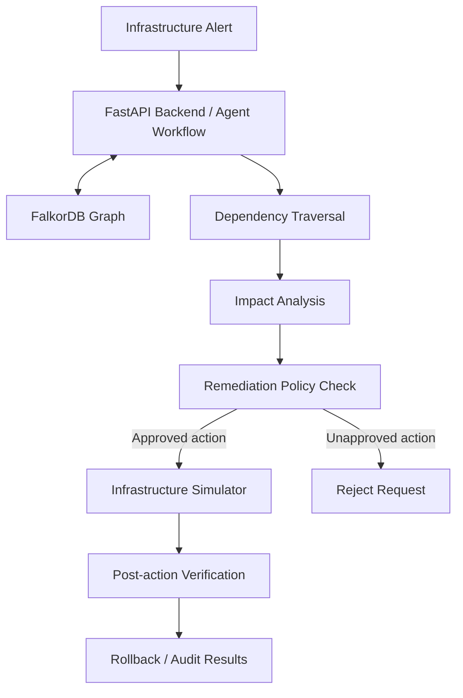

# ⚡ BlastRadius Agent — Infrastructure Incident Triage & Cascading Failure Analysis

> **Track 01: Agents That Act on Connected Data**  
> Graph-powered incident intelligence using **FalkorDB**, FastAPI, and controlled remediation simulation.

[](https://www.python.org/)
[](https://fastapi.tiangolo.com/)
[](https://www.falkordb.com/)
[](https://streamlit.io/)
[](https://blastradius-agent.streamlit.app/)

**Live demo:** https://blastradius-agent.streamlit.app/

---

## 1. Overview

In a microservice architecture, an outage in one component can affect other services that depend on it. Engineers need to understand not only which component failed, but also how far the failure may spread and which customers could be affected.

**BlastRadius Agent** is a graph-powered infrastructure incident triage prototype. It models infrastructure dependencies in FalkorDB and traverses those relationships to identify direct and multi-hop impact. It also demonstrates a controlled remediation workflow using a simulator, policy checks, post-action verification, and rollback testing.

### What it does

1. Represents infrastructure components and dependency relationships in a graph.
2. Accepts an incident alert and identifies the failing component.
3. Traverses dependency paths to find directly and transitively impacted services.
4. Connects impacted services to customer accounts in the demo topology.
5. Supports policy-controlled remediation actions in an isolated simulator.
6. Verifies simulated outcomes and tests restoration of the previous state.

> **Demo and safety disclaimer:** Infrastructure telemetry and customer records are synthetic demo data. Remediation actions are executed against a simulator; the project does not modify real production infrastructure or cloud resources.

---

## 2. Architecture & Data Flow



### Workflow modes

- **Observe and analyze:** Ingest an incident, traverse graph dependencies, and inspect potential impact.
- **Policy-controlled remediation:** Reject unapproved execution requests and permit approved actions through the simulator.
- **Verification and rollback:** Check simulated action results and test restoration of the pre-remediation state.

---

## 3. Technology Stack

- **Graph database:** FalkorDB, accessed through its Python client and Cypher queries.
- **Backend API:** FastAPI, Uvicorn, and Pydantic schemas.
- **Dashboard:** Streamlit.
- **Graph access:** FalkorDB backend, with an in-memory adapter available for local fallback/testing.
- **Testing:** pytest and a live-system verification script.

---

## 4. FalkorDB Graph Model

The graph represents infrastructure entities as nodes and their dependencies as directed relationships. Traversing these relationships lets the system follow impact across multiple hops.

### Node labels

- `Service` — application or microservice.
- `Database` — data stores used by services.
- `Queue` — messaging infrastructure.
- `Customer` — synthetic customer accounts used to demonstrate business impact.
- `Ingress` — entry points that route traffic to services.

### Relationship types

- `(:Service)-[:CALLS]->(:Service)`
- `(:Service)-[:READS_FROM]->(:Database)`
- `(:Service)-[:WRITES_TO]->(:Database)`
- `(:Service)-[:PUBLISHES_TO]->(:Queue)`
- `(:Service)-[:CONSUMES_FROM]->(:Queue)`
- `(:Customer)-[:ROUTED_THROUGH]->(:Service)`
- `(:Ingress)-[:ROUTES_TO]->(:Service)`
- `(:Service)-[:FALLBACK_TO]->(:Service)`

### Verified topology

The live-system audit verified the seeded topology with **19 nodes and 23 edges**. These counts describe the current tested demo graph and may change if the seed data is updated.

---

## 5. Quick Start

### Prerequisites

- Python 3.11 or newer
- Docker and Docker Compose
- Git

### Step 1 — Clone the repository and install dependencies

Replace `<repository_url>` with the URL of your repository.

**Windows PowerShell**
```powershell
git clone <repository_url>
cd graphs_hack
python -m pip install -r requirements.txt
```

**Linux / macOS**
```bash
git clone <repository_url>
cd graphs_hack
python -m pip install -r requirements.txt
```

### Step 2 — Configure environment variables

Copy the example environment file:

```powershell
Copy-Item .env.example .env
```

Configure these values as needed:

| Variable | Purpose | Default |
|---|---|---|
| `FALKORDB_HOST` | FalkorDB host reachable from the API process | `localhost` |
| `FALKORDB_PORT` | FalkorDB port | `6379` |
| `FALKORDB_GRAPH_NAME` | Graph name | `blast_radius` |
| `ALLOW_MEMORY_FALLBACK` | Whether local in-memory fallback is allowed when FalkorDB is unavailable | Project configuration |

**Connection note:** If the API runs directly on Windows while FalkorDB is exposed through Docker on the same machine, `127.0.0.1` may be the appropriate host. If the API runs inside Docker Compose, use the FalkorDB service name on the Compose network. Configure the host according to where the API process runs.

### Step 3 — Start FalkorDB

```bash
docker compose up -d
docker ps
```

Wait until the FalkorDB container is healthy before starting the API.

### Step 4 — Seed the graph

```powershell
python scripts/seed_graph.py
```

### Step 5 — Start the API

```powershell
python -m uvicorn app.main:app --host 127.0.0.1 --port 8000 --reload
```

Open the interactive API documentation at:

http://127.0.0.1:8000/docs

### Step 6 — Start the Streamlit dashboard

In a second terminal:

```powershell
streamlit run app/ui/dashboard.py
```

Open the dashboard at:

http://localhost:8501

---

## 6. Demo Walkthrough: Database Incident

1. Open the Streamlit dashboard.
2. Confirm that the application reports **FalkorDB** as the active backend when the database is running.
3. Run the available database-saturation demo incident, or submit an incident through the UI/API.
4. Inspect the identified failing component and the dependency graph traversal results.
5. Review the directly impacted services and downstream services.
6. Inspect the customer accounts identified by the demo topology.
7. Review the proposed remediation actions.
8. Confirm that unapproved execution is rejected.
9. Execute approved actions in the simulator and inspect the verification results.
10. Run rollback and confirm that the pre-remediation state is restored.

The verified example incident uses `user-creds-postgres` as the failing component. The audit identified `auth-service` and `user-profile-service` as directly impacted, `payment-service` and `order-service` as transitively impacted, and four customer accounts in the demo data.

> Dashboard labels and navigation may vary as the UI evolves. Use the controls shown in your current deployment.

---

## 7. Example Alert Payload

The following is an example synthetic alert. Adjust the fields to match the API schema in the current version of the application.

```json
{
  "alert_id": "alert-db-saturation-01",
  "component_name": "user-creds-postgres",
  "alert_type": "ConnectionPoolExhaustionAndHighCPU",
  "severity": "critical",
  "timestamp": "2026-10-18T20:30:00Z",
  "telemetry": {
    "cpu_percent": 96.4,
    "connection_pool_usage": 0.98,
    "active_connections": 196,
    "max_connections": 200,
    "waiting_queries": 48
  },
  "description": "Synthetic demo alert for high database CPU and connection-pool saturation."
}
```

Save the payload as `alert.json`, then submit it to the local API:

```bash
curl -X POST "http://127.0.0.1:8000/alert" \
  -H "Content-Type: application/json" \
  -d @alert.json
```

Refer to the live API documentation at `http://127.0.0.1:8000/docs` for the current endpoint schema.

---

## 8. Verification & Tests

### Run the automated tests

```powershell
python -m pytest tests/ -v
```

### Run the live-system audit

With the API running and FalkorDB reachable:

```powershell
python scripts/verify_live_system.py
```

The latest reported live-system audit completed with **10 passed, 0 failed, and 0 skipped**.

The audit covered:

- API reachability.
- Active backend identification and health reporting.
- Live FalkorDB connectivity.
- Graph overview counts.
- Incident ingestion and multi-hop dependency traversal.
- Request validation.
- Rejection of unapproved remediation.
- Simulated remediation and post-action verification.
- Rollback to the exact pre-remediation state.
- Correct `404` handling for a missing incident.

The live-system audit and the pytest suite are separate checks; their counts should not be treated as interchangeable.

---

## 9. Safety, Limitations & Future Work

### Safety

- Remediation actions run against an isolated simulator, not real infrastructure.
- Unapproved execution requests are rejected.
- Simulated actions are verified, and rollback is tested.
- Demo telemetry and customer records are synthetic.

### Current limitations

- The project demonstrates an incident-response workflow; it is not a production SRE platform.
- Remediation does not change real cloud resources or production databases.
- Impact analysis depends on the accuracy and completeness of the modeled graph.
- In-memory fallback is useful for local testing, but it should not be confused with a live FalkorDB connection. Confirm the active backend in the health endpoint before a demo.

### Future work

- Integrate authenticated, real telemetry sources.
- Add graph freshness checks and richer observability.
- Improve incident history and audit-report export.
- Add more graph-based validation scenarios and failure-injection tests.
- Explore integrations with monitoring and incident-management systems.

---

## 10. Links

- **Live demo:** https://blastradius-agent.streamlit.app/
- **FalkorDB:** https://www.falkordb.com/
- **FastAPI documentation:** https://fastapi.tiangolo.com/
- **Streamlit documentation:** https://docs.streamlit.io/

---

*Built as a prototype for Track 01: Agents That Act on Connected Data.*
