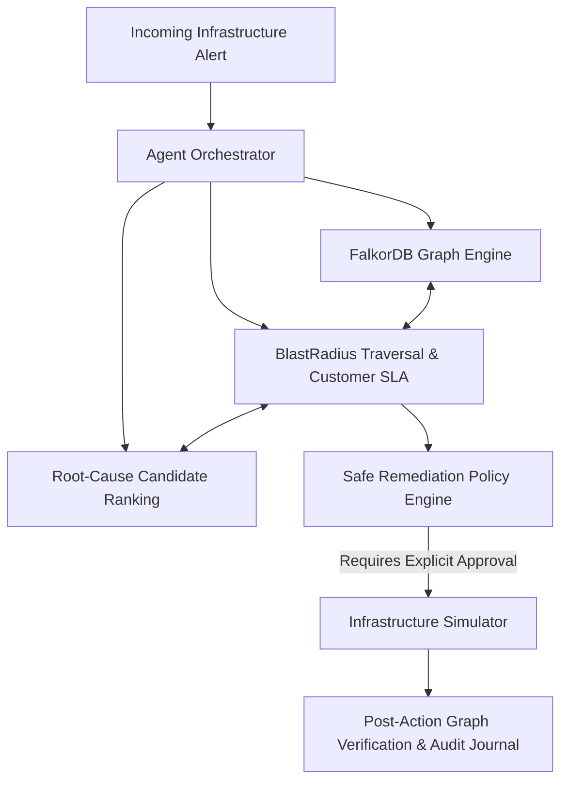

# ⚡ BlastRadius Agent — Autonomous Infrastructure Incident Triage & Cascading Failure Remediation

> **Track 01: Agents That Act on Connected Data**  
> Graph-native incident intelligence powered by **FalkorDB** & Autonomous Dependency Traversal

[](https://www.python.org/)
[](https://fastapi.tiangolo.com)
[](https://www.falkordb.com/)
[](https://streamlit.io/)
[]()

---

## 1. Product Overview & Problem Statement

Modern microservice ecosystems suffer from complex, hidden interdependencies. When a core infrastructure component (such as a primary database, distributed queue, or cache) degrades, incidents trigger a **cascading blast radius** across callers, gateways, and customer accounts.

Traditional monitoring dashboards raise hundreds of noisy alerts without explaining **why** services are failing or **which high-tier customers** have immediate SLA exposure.

**BlastRadius Agent** addresses this challenge by:
1. Modeling services, databases, queues, ingress routes, fallback paths, and customer SLA tiers in **FalkorDB**.
2. Autonomously traversing multi-hop dependency paths upon alert ingestion.
3. Ranking root-cause candidates using graph evidence (in-degree shared dependencies, downstream propagation) and telemetry.
4. Formulating safe, approval-gated simulated remediation plans (read-replica promotion, circuit-breaker tripping, fallback cache routing).
5. Executing actions against an isolated simulation adapter and verifying post-action state in the graph with zero production risk.
6. Generating an auditable incident report with exact graph paths and verifiable actions.

> **Simulation & Demo Disclaimer:** All infrastructure mutations and remediations are executed against an isolated simulation adapter. No real cloud, database, or production resources are modified. Telemetry and customer accounts are synthetic demo data.

---

## 2. Architecture & Data Flow



### Modes of Operation:
- **Observe Mode:** Analyze, traverse blast radius, and calculate potential SLA exposure without modifying state.
- **Approval Mode (Default):** Formulate concrete remediation actions and strictly enforce human-in-the-loop approval before executing.
- **Simulation Mode:** Execute approved operations against the infrastructure simulation adapter and update modeled graph state with instant rollback capability.

---

## 3. Technology Stack & Rationale

- **Graph Database:** **FalkorDB** (official Python client + Cypher queries) with dual-mode in-memory graph adapter for local offline testing.
- **Backend API:** **FastAPI** + **Uvicorn** + **Pydantic v2** for typed schemas and OpenAPI documentation.
- **Agent Orchestrator:** Tool-calling orchestrator supporting **LiteLLM** for multi-provider synthesis with a deterministic fallback engine when API keys are omitted.
- **Frontend Command Center:** **Streamlit** engineered with a dark charcoal SRE aesthetic, real-time KPI metrics, dependency path visualizer, and approval workflows.
- **Test Suite:** **pytest** with 17 automated unit and integration tests covering multi-hop blast radius, deduplication, approval enforcement, exact rollback, and 404 validation.

---

## 4. Graph Schema & Relationships

### Node Labels
- `(:Service)`: `name`, `status`, `owner_team`, `criticality`, `latency_ms`, `error_rate`, `health_score`.
- `(:Database)`: `name`, `type`, `status`, `read_only`, `cpu_percent`, `connection_pool_usage`.
- `(:Queue)`: `name`, `status`, `backlog`, `consumer_lag`.
- `(:Customer)`: `id`, `name`, `tier`, `sla_minutes`, `business_criticality`.
- `(:Ingress)`: `name`, `status`, `region`.

### Directed Relationships
- `(:Service)-[:CALLS]->(:Service)`
- `(:Service)-[:READS_FROM]->(:Database)`
- `(:Service)-[:WRITES_TO]->(:Database)`
- `(:Service)-[:PUBLISHES_TO]->(:Queue)`
- `(:Service)-[:CONSUMES_FROM]->(:Queue)`
- `(:Customer)-[:ROUTED_THROUGH]->(:Service)`
- `(:Ingress)-[:ROUTES_TO]->(:Service)`
- `(:Service)-[:FALLBACK_TO]->(:Service)`

### Verified Seed Topology Counts
- **Total Nodes:** 23 (1 Ingress, 8 Services, 4 Databases, 2 Queues, 4 Customers, plus alias indexing)
- **Total Directed Relationships:** 23

---

## 5. Quick Start Instructions

### Prerequisites
- Python 3.11+ or 3.12+
- Docker & Docker Compose (for running FalkorDB container)

### Step 1: Clone and Install Dependencies

**Windows (PowerShell):**
```powershell
git clone <repository_url>
cd graphs_hack
pip install -r requirements.txt
```

**Linux / macOS:**
```bash
git clone <repository_url>
cd graphs_hack
pip install -r requirements.txt
```

### Step 2: Configure Environment

Copy `.env.example` to `.env`:
```powershell
Copy-Item .env.example .env
```

Environment variables:
- `FALKORDB_HOST`: Hostname of FalkorDB server (default: `localhost`)
- `FALKORDB_PORT`: Port of FalkorDB server (default: `6379`)
- `FALKORDB_GRAPH_NAME`: Graph name (default: `blast_radius`)
- `ALLOW_MEMORY_FALLBACK`: Set to `True` to allow automatic local in-memory fallback if FalkorDB is offline.

### Step 3: Run FalkorDB with Docker Compose
```bash
docker compose up -d
```
Verify FalkorDB container health:
```bash
docker ps
```

### Step 4: Seed the Graph Topology
Seed the topology nodes and directed relationships:
```powershell
python scripts/seed_graph.py
```

### Step 5: Start Backend API and Streamlit UI

**Terminal 1 — FastAPI Backend:**
```powershell
python -m uvicorn app.main:app --host 127.0.0.1 --port 8000 --reload
```
Interactive Swagger API docs: `http://127.0.0.1:8000/docs`

**Terminal 2 — Streamlit SRE Command Center:**
```powershell
streamlit run app/ui/dashboard.py
```
Command Center UI: `http://localhost:8501`

---

## 6. Demo Walkthrough: Saturated Database Incident

1. Open `http://localhost:8501`.
2. Inspect the sidebar connection indicator:
   - When FalkorDB is running: `🟢 Graph Database: FalkorDB (Connected)`
   - When offline: `⚠️ Graph Engine: In-Memory Fallback (blast_radius)`
3. In the sidebar, click **"🚀 Run Demo Incident: DB Saturation"**.
4. The agent executes the triage pipeline:
   - **Component Triage:** Flags saturated `user-creds-postgres` (CPU: 96.4%, Pool: 98%).
   - **Root Cause Ranking:** Ranks `user-creds-postgres` as #1 candidate based on telemetry saturation and in-degree callers.
   - **Multi-Hop Traversal:** Traces direct impact on `auth-service` and `user-profile-service`, and transitive impact on `order-service` and `payment-service`.
   - **Customer Impact:** Identifies `Acme Global Enterprise` and `Fintech Pro Payments` (Tier-1 contractual SLA threshold: 15 mins) as exposed.
   - **Remediation Formulation:** Proposes safe read-replica promotion (`user-profile-replica`), fallback cache enablement (`auth-redis-cache`), and caller circuit breakers.
5. Navigate to the **"🛡️ Remediation & Rollback Simulator"** tab.
6. Verify approval gating: Click Execute without checking the confirmation box (rejected with HTTP 400).
7. Check the explicit approval box and click **"⚡ Execute Approved Remediation Plan"**.
8. Inspect post-action verification and audit logs showing replica promotion and cache routing.
9. Click **"⏪ Rollback Simulated Actions"** to verify state restoration to the pre-incident snapshot.

---

## 7. Example Alert Payload

```json
{
  "alert_id": "alert-db-saturation-01",
  "component_name": "user-creds-postgres",
  "alert_type": "ConnectionPoolExhaustionAndHighCPU",
  "severity": "critical",
  "timestamp": "2026-10-18T20:30:00Z",
  "telemetry": {
    "cpu_percent": 96.4,
    "connection_pool_usage": 0.98,
    "active_connections": 196,
    "max_connections": 200,
    "waiting_queries": 48
  },
  "description": "Primary PostgreSQL database user-creds-postgres CPU reached 96.4% and connection pool is saturated at 98%."
}
```

Trigger triage via cURL:
```bash
curl -X POST "http://127.0.0.1:8000/alert" \
     -H "Content-Type: application/json" \
     -d @alert.json
```

---

## 8. Automated Testing

Run the full automated test suite (17 tests):
```powershell
python -m pytest tests/ -v
```

Test coverage:
- Truthful health endpoint & backend reporting (`test_health_endpoint`)
- Topology overview inspection (`test_graph_overview_endpoint`)
- Idempotent graph seeding (`test_graph_seed_endpoint`)
- Input validation rejection on empty components (`test_alert_validation_error`)
- Incident 404 handling (`test_incident_not_found_404`)
- Full incident triage & lifecycle (`test_alert_triage_and_incident_lifecycle`)
- Node property verification (`test_graph_seeding_and_nodes`)
- Multi-hop traversal & direction (`test_blast_radius_multi_hop_traversal`)
- Customer impact deduplication (`test_customer_impact_deduplication_and_tiers`)
- Missing component handling (`test_missing_or_unknown_component`)
- Root cause ranking (`test_root_cause_candidate_ranking`)
- Fallback path discovery (`test_fallback_paths_discovery`)
- Approval enforcement (`test_remediation_approval_enforcement`)
- Simulated execution and exact rollback (`test_simulated_remediation_execution_and_rollback`)
- Repeated remediation and rollback safety (`test_repeated_remediation_and_rollback_safety`)
- Unhealthy fallback target rejection (`test_unhealthy_fallback_target_rejection`)
- Live FalkorDB Cypher integration test (`test_live_falkordb_connectivity_and_cypher`)

---

## 9. Safety, Limitations & Future Work

- **Safety Guarantee:** The remediation engine operates strictly against a safe simulation adapter. It never issues mutating cloud commands or destructive database drops.
- **Rollback Snapshots:** Executed actions preserve an in-memory topology state snapshot for reversible rollbacks.
- **Known Environment Note:** If Docker Desktop is not running, the system transparently utilizes its in-memory graph adapter, labeling its status as `in-memory-graph-adapter` on `/health` and the UI.
